# Hi, I'm Saahil Mahato 👋

**Software Development Engineer II @ IQVIA**

I'm a software engineer interested in building reliable software and understanding the systems that make it work.

My day-to-day work focuses on backend development with Java and Spring Boot, alongside frontend development. Outside of work, I'm exploring operating systems, networking, system design, and AI to deepen my understanding of computer science fundamentals.

I enjoy solving practical engineering problems, learning how things work under the hood, and building projects that turn ideas into working software.

## 🛠️ Technologies

**Languages**

**Frameworks & Libraries**

I choose tools based on the problem at hand, with a particular interest in backend engineering, API design, and efficient systems.

## 📚 Currently Exploring

- **Computer science fundamentals:** Operating systems and networking
- **System design:** Distributed systems, scalability, and reliability
- **AI & machine learning:** Understanding the technology beyond the API

## 📊 GitHub Activity

## 🔗 Find Me Elsewhere

